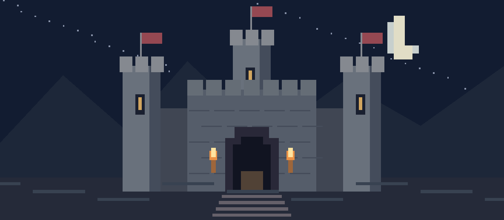

<div align="center">



# EUDORIA

**Uma dungeon. Mil escolhas ruins. Mais um café?**

</div>

> Para passar o tempo no trabalho enquanto espera 127 chamados sem resposta. :D
>
> No mínimo, aqui o inimigo responde.

Escolha sua classe, atravesse uma dungeon cheia de portas suspeitas e tente não gastar a última poção antes do chefe. **Eudoria** é um RPG solo em Java, com combate ATB, pixel art original, relíquias e decisões que podem dar muito certo... ou muito errado.

**Uma aventura para os intervalos entre um café e outro.** Não inclui áudio, grupo de personagens ou garantia de aprovação do seu gerente.

## 🎮 Quero jogar!

### Windows: pacote portátil

1. Baixe `Eudoria-Windows-x64.zip` na página **Releases** do repositório, quando houver uma versão publicada.
2. Extraia **todo o ZIP** para uma pasta. O `.exe` precisa dos arquivos que vêm junto com ele.
3. Abra `Eudoria\Eudoria.exe` e escolha **Novo jogo**.

O pacote é para **Windows x64**, inclui o ambiente Java necessário e não exige instalar Java ou o jogo. Ele não é um executável independente de arquivo único: mantenha a pasta extraída intacta. A primeira execução pode exibir avisos de segurança do Windows porque o aplicativo não é assinado.

Ainda não há release? Quem tiver o código pode gerar o ZIP localmente seguindo as instruções de [geração do pacote](#-gerar-o-pacote-windows). As partidas são salvas no perfil do usuário, em `%USERPROFILE%\.eudoria\runs.dat`.

### Linux: pacote portátil

1. Baixe `Eudoria-Linux-x64.tar.gz` na página **Releases**, quando houver uma versão publicada.
2. Extraia o arquivo e abra `Eudoria/bin/Eudoria`. Pelo terminal:

   ```bash
   tar -xzf Eudoria-Linux-x64.tar.gz
   ./Eudoria/bin/Eudoria
   ```

O pacote inclui Java e precisa de Linux x64 com ambiente gráfico e bibliotecas gráficas usuais. Não é necessário instalar Java. Mantenha a pasta extraída intacta. Os saves ficam em `~/.eudoria/runs.dat`.

### Executar a partir do código

Precisa de **JDK 11 ou superior** e de um ambiente gráfico. No PowerShell, na pasta do projeto:

```powershell
$fontes = Get-ChildItem -Path .\desafio1 -Filter *.java -Recurse | ForEach-Object { $_.FullName }
javac -encoding UTF-8 -d build $fontes
java -cp build desafio1.Main
```

Também é possível abrir o projeto na IDE e executar `desafio1.Main`.

## 🧭 Manual rápido do aventureiro

- **Guerreiro:** entra pela porta da frente e pergunta pela armadura depois.
- **Mago:** transforma mana em problemas para os outros.
- **Ladino:** resolve pendências com golpes rápidos e um toque de veneno.
- **Expedição:** atravesse três capítulos conectados, vença seus chefes e desbloqueie Ascensões.
- **Ondas infinitas:** inimigos cada vez mais fortes. O RH ainda está avaliando os riscos.

### Como jogar

1. Na tela inicial, com o castelo em pixel art, clique em **Novo jogo**. Escolha um nome, uma das três classes e o modo **Expedição** ou **Ondas infinitas**. Cancelar a criação retorna ao menu. Você começa com 60 ouro e nenhuma poção: compre suprimentos na loja de preparação.
2. Selecione um inimigo clicando no sprite na arena 2D ou na lista. A marca dourada indica o alvo. As barras ATB avançam automaticamente; quando a sua enche, o tempo é pausado até você escolher uma ação.
3. Ataque, use a habilidade da classe gastando mana, **Defenda**, consuma uma poção ou, com a barra LIMIT cheia, desencadeie o Limit Break. Uma ação válida gasta sua barra; escolhas inválidas não gastam o turno.
4. No modo **Ondas**, ao vencer, receba XP e ouro e recupere 25% da vida e mana máximas. No intervalo, escolha entre melhorias permanentes e suprimentos. Os inimigos sobem um nível a cada três ondas, recebem reforços a cada cinco e um guardião aparece a cada cinco ondas.
5. Na **Expedição**, escolha no mapa uma das portas conectadas destacadas. O conteúdo de cada sala só é revelado ao entrar; caminhos não escolhidos ficam para trás. Cada capítulo tem sete salas e um chefe. Vença os três capítulos para encerrar com vitória ou iniciar uma **Ascensão** mais difícil, mantendo o herói. **Menu inicial** salva a partida e retorna à tela inicial.

Cada classe cresce de forma diferente ao subir de nível e, a cada nível, a tela **LEVEL UP** pede a escolha de um bônus extra: **Força** (+3 de poder), **Vigor** (+20 de vida máxima), **Agilidade** (+2 de destreza: ATB mais rápido e defesa) ou **Espírito** (+15 de mana máxima). O nível é aplicado logo ao fim do combate, nos dois modos; com vários níveis de uma vez, a tela aparece uma vez por nível. A loja aumenta permanentemente o poder ou a vida máxima durante a partida; poções só podem ser compradas. A vida restaurada nunca ultrapassa o máximo.

<details>
<summary>📜 Quero saber mais sobre as regras</summary>

## Expedição pela dungeon

Cada capítulo gera sua própria distribuição de salas e conexões. O mapa tem paredes de alvenaria, corredores e portas de pedra com tochas. Salas inexploradas usam o mesmo sprite, inclusive lojas, eventos, elites e chefe; dicas do mouse e acessibilidade também não revelam seu conteúdo. Portas acessíveis ficam iluminadas e a posição atual aparece em dourado. Só as salas visitadas mostram seus símbolos. Em cada capítulo, atravesse sete salas e vença o chefe na oitava. O mapa se ajusta automaticamente ao tamanho da janela, sem barras de rolagem.

### Capítulos e pós-jogo

1. **Ruínas do Castelo:** o Guardião das Ruínas usa Impacto devastador. Mantém as fraquezas, resistências e aparência do Guardião original.
2. **Catacumbas Arcanas:** o Arquimago das Catacumbas usa Tempestade arcana, com o estilo do Arauto: resistência física e fraqueza perfurante. Introduz a **Fonte arcana**.
3. **Cidadela do Eclipse:** o Soberano do Eclipse usa Lâmina do eclipse, com o estilo ágil do Duelista: resistência perfurante e fraqueza mágica. Introduz a **Forja esquecida**.

Após cada chefe, escolha os bônus de nível pendentes e clique em **Próximo capítulo**. O próximo mapa começa na loja de preparação. Nível, XP, atributos, melhorias, ouro, poções, vida/mana atuais, LIMIT e relíquias ativas ou pendentes são preservados; a transição não cura o herói nem reaplica bônus de relíquias.

Depois do terceiro chefe, escolha **Encerrar com vitória** ou **Iniciar Ascensão 1**. Cada Ascensão percorre os três capítulos novamente, gerando novos mapas e aumentando continuamente a dificuldade e as recompensas. Durante as Ascensões, também é possível encerrar com vitória após os chefes intermediários. Voltar ao menu antes de decidir mantém a partida carregável. Morrer encerra a run como derrota, inclusive no pós-jogo.

Das 21 salas intermediárias disponíveis no mapa, 13 são combates (incluindo elites), duas são eventos, três são lojas e três são descansos. As camadas 1, 2, 4 e 6 sempre exigem luta: qualquer rota passa por pelo menos quatro batalhas antes do chefe. Eventos e serviços ficam nas camadas 3, 5 e 7, com alternativas de combate na última. Planeje compras e treinamento, em vez de guardar todo o ouro até o chefe.

No primeiro capítulo, os encontros comuns têm um inimigo até a quinta camada e dois a partir da sexta. Nos capítulos seguintes, os grupos aumentam conforme a profundidade efetiva: a partir da segunda sala do capítulo 2, os encontros comuns sempre têm dois inimigos. Elites mantêm dois inimigos; cada chefe luta sozinho. Essa regra não altera os grupos das ondas infinitas.

- **Combate:** concede XP e ouro, mas não recupera vida/mana. Ao alcançar um novo nível, a tela de LEVEL UP aparece imediatamente.
- **Elite:** encontro mais forte, recompensa em XP e ouro dobrada e escolha de uma relíquia guardada. Ela só altera atributos quando ativada na loja ou no descanso.
- **Evento:** baú, altar ou armadilha, cada qual com ilustração e uma tela de consequência. Os botões mostram custos e riscos antes da escolha; o baú arriscado tem 50% de chance de ouro e 50% de dano. O Ladino recebe vantagens em algumas escolhas. O altar arriscado oferece uma relíquia pendente, sem aplicar atributos imediatamente.
  - **Fonte arcana (capítulo 2 em diante):** beber recupera 25% da vida máxima; canalizar gasta 20 mana e carrega 50% de LIMIT.
  - **Forja esquecida (capítulo 3):** gastar 10 mana guarda um Amuleto; sacrificar 25% da vida máxima guarda um Foco, apenas se o herói sobreviver. As relíquias precisam ser ativadas normalmente.
- **Descanso:** escolha apenas uma ação: recuperar 40% da vida, recuperar 40% da mana, **Concentrar** (+50% da barra LIMIT) ou ativar uma relíquia. Se não houver nada a recuperar, é possível seguir sem benefício.
- **Loja:** compre poções/melhorias ou ative relíquias guardadas. Melhorias compradas de atributos só existem aqui. Compras só são permitidas na preparação e nas salas de loja; durante as batalhas da expedição o painel da loja fica oculto.
- **Chefe:** conclui o capítulo e libera a continuação. O terceiro libera o encerramento com vitória ou uma nova Ascensão. Se a vida chegar a zero, inclusive em um evento, a expedição termina.

Vida, mana, ouro, poções, experiência e recompensas pendentes são preservados entre salas. As relíquias e melhorias duram apenas na partida atual. Cada relíquia tem sprite próprio (Lâmina: espada, Amuleto: pingente com gema, Foco: orbe arcano) e aparece na vitrine "Relíquias" do HUD da expedição e da ficha do herói na batalha. Relíquias ativas ficam em destaque e agrupadas com contador (ex.: x2); pendentes aparecem esmaecidas até serem ativadas. O mapa e o castelo usam pixel art original, desenhada em Java, sem arquivos externos. O progresso é salvo automaticamente (veja "Salvamento e estatísticas").

## Limit Break, intenção e efeitos de status

- **Defender:** disponível para todas as classes, nos dois modos. Consome a vez, sem gastar mana nem carregar LIMIT por ação. Reduz o dano de todos os ataques e habilidades inimigas em **50% + 1 ponto percentual a cada 5 de Constituição**, até **65%**: CON 10 → 52%; CON 30 → 56%; CON 75 ou mais → 65%. A proteção dura até o início da próxima vez do herói; não acaba após o primeiro golpe nem acumula. A redução é aplicada depois da defesa normal, com o dano final arredondado para baixo e mínimo de 1. A intenção exibida já considera a proteção ativa; o HUD, a dica do botão e o escudo azul mostram a porcentagem atual. A Constituição aparece na ficha como CON; melhorias de vitalidade, Amuletos e o crescimento natural da classe atualizam o bônus. O bônus de nível Vigor aumenta apenas a vida máxima, não a Constituição. Estatísticas e carga de LIMIT por dano recebido consideram apenas a vida realmente perdida. A proteção é salva durante o combate e termina ao encerrar o encontro ou morrer.

- **Limit Break:** a barra LIMIT (vermelha) persiste entre encontros e capítulos até ser usada. Ela enche ao receber dano (proporcional à vida máxima), +4% a cada ataque ou habilidade, +8% a cada inimigo abatido e +50% ao Concentrar no descanso. Com ela cheia, o botão **LIMIT** fica disponível na sua vez:
  - Guerreiro — **Fúria titânica:** golpe de 5× poder que rompe a armadura e atordoa.
  - Mago — **Meteoro:** golpe de 3× poder em cada inimigo vivo e queimadura.
  - Ladino — **Mil cortes:** três golpes de 1,25× poder e um acúmulo de veneno.
  - Não custa mana; defesa, fraquezas e resistências continuam valendo. Os efeitos de status mantêm a duração das habilidades comuns.
- **Efeitos das habilidades:** os efeitos correm no tempo do ATB, não por ação do inimigo.
  - **Atordoamento** (Golpe devastador): congela o ATB do alvo por 18 instantes (barra cinza e estrelas na arena). Depois, o alvo fica imune até agir de novo.
  - **Queimadura** (Explosão arcana): 3 pulsos de `poder / 8` de dano.
  - **Veneno** (Lâmina veloz): 5 pulsos de `poder / 5` de dano. Acumula até x3: cada aplicação soma um acúmulo e renova a duração.
  - Os pulsos ocorrem a cada 20 instantes, ignoram armadura e resistências e podem finalizar inimigos. A ficha do alvo mostra acúmulos, dano por pulso e o congelamento.
- **Intenção:** cada inimigo exibe a próxima ação e o dano previsto, também mostrados na lista e na ficha do alvo. Selos VEN xN, QUE e ATORD. indicam os efeitos ativos e o dano por pulso.

## Salvamento e estatísticas

O menu inicial oferece **Novo jogo**, **Carregar**, **Estatísticas** e **Sair**. A partida é salva automaticamente em `~/.eudoria/runs.dat` a cada mudança importante (sala, onda, turno, ouro ou nível), ao voltar ao menu e ao fechar a janela.

- **Carregar** lista só as runs em andamento; selecione uma e clique em **Continuar run**.
- **Estatísticas** lista todas as runs (em andamento, vitórias e derrotas). A run selecionada mostra herói, classe, nível, modo, progresso, datas, abates, chefes finalizados, mortes, encontros vencidos, dano causado e recebido, Limit Breaks usados e ouro obtido. O rodapé soma runs, vitórias, mortes, abates e chefes de todas as runs.
- Runs encerradas mantêm apenas o resumo. Um arquivo de save corrompido é ignorado, sem impedir o jogo de abrir.
- Capítulo e Ascensão aparecem no progresso salvo. Saves antigos em andamento continuam no capítulo 1; vitórias antigas já encerradas permanecem no histórico, pois não possuem mais o estado jogável.
## Dificuldade e habilidades inimigas

O custo de subir de nível é `110 + 40 × nível²` XP (150 para o nível 2). No modo de ondas, cada onda rende `20 + 5 × onda` XP; na expedição, o XP depende da profundidade e do tipo de encontro.

Cada inimigo usa sua habilidade a cada terceira ação:

- **Sentinela — Golpe perfurante:** reduz a proteção da defesa.
- **Espreitador — Ataque duplo:** dois golpes, com a defesa aplicada em cada um.
- **Arauto — Rajada arcana:** dano aumentado e penetração de defesa. Fraco a perfurante e resistente a físico.
- **Golem de ferro — Abalo sísmico:** armadura pesada, resistência mágica e habilidade que ignora boa parte da defesa. Pressiona o Mago; golpes perfurantes do Ladino exploram suas juntas. O Guerreiro precisa do Golpe devastador para atravessar a armadura.
- **Duelista — Contraestocada:** ATB mais rápido, resistência a golpes perfurantes e habilidade com penetração de defesa. Pressiona o Ladino; sua fraqueza é magia.
- **Guardião — Impacto devastador:** golpe de alto dano. Fraco a físico e resistente a perfurante.

Os novos tipos entram progressivamente na rotação de ondas e nos encontros da dungeon. Eles não são imunes: melhorias de poder e habilidades continuam úteis mesmo contra resistências. Golem e Duelista possuem sprites próprios, com silhuetas diferentes dos monstros anteriores.

Ao selecionar um inimigo, a ficha mostra o nível de armadura, sua redução percentual, a fraqueza, a resistência e a classe recomendada. O Guerreiro causa dano físico, o Mago dano mágico e o Ladino dano perfurante. Explorar a fraqueza aumenta o dano em 25%; atacar uma resistência reduz o dano em 20%. Armadura reduz o dano físico em 2% por ponto, até o limite de 30%, antes desses modificadores; golpes perfurantes sofrem metade dessa redução e magia a ignora. O Golpe devastador do Guerreiro rompe a armadura. Cada tipo de dano é fraqueza de dois inimigos e resistência de outros dois. O aviso curto também confirma quando a fraqueza é explorada ou o golpe é resistido.

Os inimigos comuns têm `38 + 10 × nível` de vida antes dos reforços, em vez de `30 + 8 × nível`; a vida do chefe foi mantida. Assim, um Mago inicial sem melhorias não elimina Sentinelas ou Golems com uma única habilidade. Sentinelas continuam vulneráveis à magia, mas Golems a resistem: a vantagem do Mago depende do encontro. A defesa do herói é `constituição + destreza / 2`, e as habilidades custam 10 MP (Guerreiro), 22 MP (Mago) e 15 MP (Ladino).

Na expedição, a profundidade efetiva é `andar + 4 × etapa`, sendo `etapa = 3 × Ascensão + capítulo - 1` (Ascensão zero na campanha inicial). Os inimigos têm nível `1 + (profundidade - 1) / 2`, mais um nível para o chefe, e um reforço a cada três unidades de profundidade. XP e ouro também acompanham essa profundidade. A rotação dos encontros muda com ela.

O balanceamento é acompanhado por `desafio1.jogo.SimulacaoBalanceamento`. Por padrão, ele mede apenas o primeiro capítulo, preservando a comparação com a versão anterior: em 400 sementes, a IA venceu 52,5% com Guerreiro, 61% com Mago e 68,3% com Ladino. Para simular os três capítulos, execute `java -cp build desafio1.jogo.SimulacaoBalanceamento 200 campanha`. Em 200 sementes, as três classes conseguiram concluir a campanha sem atributos extras concedidos pelo teste. Esses números não representam a taxa de vitória de jogadores.

O nível, os reforços, o poder, a defesa e a próxima ação aparecem na lista de inimigos. Abaixo de cada inimigo, a arena mostra sua intenção: a próxima ação e o dano previsto contra a sua defesa atual (em laranja quando é uma habilidade). A pausa ATB durante a escolha foi preservada.

Esta versão usa um único herói e uma arena 2D em Swing, sem áudio ou grupo de personagens. As ondas continuam enquanto o herói sobreviver.

### Batalha com sprites

A arena mostra o herói à esquerda e até três inimigos à direita, em um cenário de ruínas. Os sprites pixel art são originais, gerados em memória, sem downloads ou arquivos externos. Cada classe tem aparência e arma próprias; os tipos de inimigos têm cores distintas e o guardião é maior.

Os painéis de batalha e expedição usam sprites de coração para vida, gota azul para mana e estrela violeta para XP, preservando nomes e valores numéricos. Na batalha, XP também possui sua própria barra de progresso.

Há animação de repouso, avanço no ataque, projéteis para golpes e habilidades, tremor ao receber dano e números flutuantes de dano e cura. Inimigos derrotados ficam esmaecidos. Vida, ATB, níveis e avisos de habilidade aparecem na arena; os detalhes continuam na lista. As animações são apenas visuais: não alteram o tempo do combate ou a pausa ATB. A arena escala proporcionalmente ao redimensionar a janela.

A coluna do herói, comandos e loja possui rolagem quando não cabe na janela, evitando sobreposição no modo de ondas. Se necessário, role essa coluna para acessar os botões inferiores.

Não há painel de histórico de combate. Uma linha no rodapé mostra apenas a mensagem mais recente, incluindo avisos de mana ou ouro insuficiente, sem acumular texto na interface.

</details>

## 📦 Gerar o pacote Windows

No Windows x64, instale um **JDK 17 ou superior** com `javac`, `jar`, `jlink` e `jpackage` (por exemplo, Eclipse Temurin 21), configure `JAVA_HOME` para esse JDK e execute no PowerShell:

```powershell
.\gerar-windows.ps1
```

O script cria `dist\Eudoria\Eudoria.exe` e `dist\Eudoria-Windows-x64.zip`, sem alterar saves nem substituir um pacote existente. O ZIP pode ser distribuído aos jogadores; respeite as licenças do JDK usado para gerá-lo. Para gerar novamente, mova ou remova primeiro os dois resultados anteriores.

No GitHub, o workflow **Pacotes e release** pode ser executado manualmente pela aba Actions para gerar os pacotes como artefatos. Ao enviar uma tag começando com `v` (por exemplo `v1.0.0`), ele aguarda a geração dos dois pacotes e os anexa a uma release. Isso exige habilitar Actions e permissões de escrita para releases; gerar o pacote localmente não o publica automaticamente.

## 🐧 Gerar o pacote Linux

Em Linux x64, instale um JDK 17 ou superior com `javac`, `jar`, `jlink` e `jpackage` (por exemplo, Eclipse Temurin 21) e execute:

```bash
bash gerar-linux.sh
```

O script cria `dist/linux/Eudoria/bin/Eudoria` e `dist/Eudoria-Linux-x64.tar.gz` sem sobrescrever resultados anteriores. O pacote é gerado para o sistema Linux usado na compilação; distribuições com bibliotecas de sistema mais antigas podem ser incompatíveis.

## Organização

- `desafio1.personagens`: atributos, classes, crescimento, vida e mana.
- `desafio1.itens` e `desafio1.interfaces`: contratos e poções reaproveitados da estrutura inicial.
- `desafio1.jogo`: estado da partida, inimigos, ATB, recompensas e loja, independentes da interface.
- `desafio1.jogo.Expedicao`: mapa conectado, regras das salas, eventos, recompensas e transições da expedição.
- `desafio1.jogo.RegistroRun` e `desafio1.jogo.Salvamento`: resumo, estatísticas e persistência das runs.
- `desafio1.visual`: janela, mapa, arena 2D, sprites originais, animações e comandos do jogador.
- `testes.TesteJogo`: testes executáveis sem dependências.

Os testes de combate incluem 48 encontros isolados (oito profundidades × três classes × duas condições de progressão), usando a mesma estratégia e recursos equivalentes. Sem melhorias, nenhuma classe deve vencer todos os encontros; a diferença de vitórias entre classes fica limitada a um encontro. Também são comparadas ações e perda percentual de vida. Isso complementa os testes de rotas completas da expedição; não representa uma taxa de vitória de jogadores.

`Equipavel` e o peso de `Item` permanecem como pontos de extensão, mas não participam da partida atual.

## Testes

No PowerShell:

```powershell
$fontes = Get-ChildItem -Path .\desafio1, .\testes -Filter *.java -Recurse | ForEach-Object { $_.FullName }
javac -encoding UTF-8 -d build $fontes
java -cp build testes.TesteJogo
java -cp build testes.TesteExpedicao
java -Djava.awt.headless=true -cp build testes.TesteArena
java -Djava.awt.headless=true -cp build desafio1.visual.TestePainelExpedicao
java -cp build desafio1.visual.TesteLayoutCombate
```

O teste de layout de combate exige ambiente gráfico, mas não abre uma janela nem grava partidas. Ele verifica comandos e loja das três classes na preparação e na batalha, incluindo a rolagem e a ausência de sobreposição.
